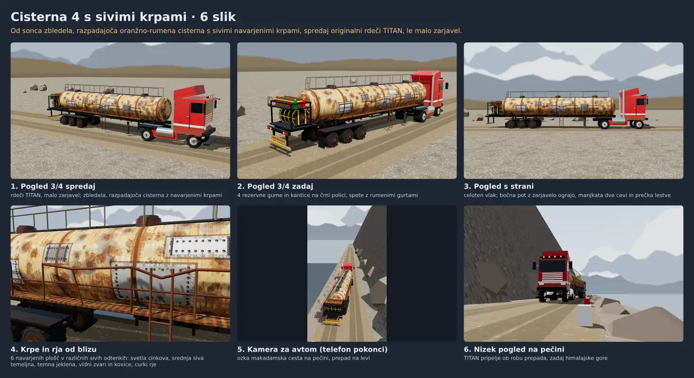

# TITAN s cisterno (načrt teme)

TITAN (`js/cars/titan.js`) vleče cisterno na sedlu: prikolica s pravim fizikalnim zgibom. Veja `titan-cisterna`, en pull request. Predaja iz seje session_01QiZPCZFYZECemerxaNXvMZ (4. 11. 2026); nadaljuje session_01Ck3D3QeTeMFcEZM6bLAKNd (sklopi 1–3), sklop 4 in naprej session_01Ck3D3TnwDBsrTGSFeJMAva (5. 11. 2026).

## Odločitve uporabnika (4. 11. 2026)
1. **Obseg »A v celoti«**: model v igri in vpis v vozni park, fizika zgiba, AI tekmeci in promet, kamera za avtom, posnetek dirke, igra na več telefonih, testi in objava. Ne zdaj: tovornjak z dvema cisternama (črna kabina, zrcalni cisterni), misija dostave goriva, ploščad s hlodi.
2. **Pravi fizikalni zgib**: prikolica je svoje telo na sedlu. V ovinku se lomi, pri zaviranju potiska, ob napaki gre v »škarje«; teža polne cisterne vpliva na vožnjo; prave trke ima z ograjo, robom in vozili in pade čez prepad (`Race._fall`), tudi sama. Ne samo kinematično sledenje poti. Kinematika prikolice iz misij (`MisKit.towTrailer`, `tow`, `trailer` v `js/missions/kit.js`) ostane za misije; od nje vzamemo, kar se da (kot prikolice za izris).
3. **Videz »cisterna 4 s sivimi krpami«** (slika zgoraj):
   - Vlačilec: originalni rdeči TITAN (oblika, barve, krom), le malo zarjavel ob spodnjih robovih, vogalih, blatnikih in stopnicah, malo prahu.
   - Cisterna: od sonca zbledela bleda oranžno-rumena, zelo močna rja s curki od obročev, kovic in pokrovov (okrogli pokrovi jaškov na vrhu ostanejo: odločitev uporabnika 9. 11. 2026 ob ~11.05, da jih odstranimo, ker so bili s kamere za avtom videti kot gume, je uporabnik ob ~12.25 preklical, »vrni nazaj okrogle pokrove«; enako na ZRCALNEM VLAKU); 6 navarjenih zakovičenih plošč v sivih odtenkih (svetlo cinkasta, srednje siv premaz, temno jeklena) z vidnim zvarom in kovicami.
   - Bočna pohodna pot z rjavo rešetko in zarjavelo ograjo; manjkata dve cevi ograje in ena prečka lestve; lestev od tal.
   - Zadaj 4 rezervne gume pokonci ena ob drugi, nad njimi črna polica, spete z rumenimi gurtnami. Kantic (12, rdeče in zelene) na polici ni več (odločitev uporabnika 9. 11. 2026: brez rezervnega bencina; polica ostane kot pokrov nad gumami). Gume so deli prikolice (`tlSpare1` do `tlSpare4`): od 50 % poškodb se sklad maja na polici, pri 80 % odpadejo (odločitev uporabnika 9. 11. 2026, `docs/deli.md` »Rezervno kolo«).
   - Samo generični napisi (npr. FLAMMABLE), brez znamk.
   - Za telefon poenostavljeno: malo klicev risanja, brez detajlov, ki jih kamera za avtom ne vidi.
4. Če je zgib nemiren (tresenje, »eksplozije« pri trkih), seja to pove uporabniku in predlaga poenostavitev (prikolica, ki sledi poti), preden porabi več časa.

## Načrt (obljubljeno ~3–5 dni)
| Sklop | Kaj | Čas | Stanje |
|---|---|---|---|
| 1 | Model v igri, vpis v vozni park | ~0,5 dneva | narejeno (5. 11.) |
| 2 | Fizika zgiba | ~1–2 dni | narejeno, uglaševanje ob AI (5. 11.) |
| 3 | AI in promet: širši zavoji tekmecev, manj tekmecev | ~0,5–1 dan | narejeno (5. 11.) |
| 4 | Kamera za dolgo vozilo, posnetek, kot prikolice med telefoni | ~0,5 dneva | narejeno (5. 11.) |
| 5 | Testi (tudi Killar, ko bo na `main`, in krožna proga), obremenitev, README, objava | ~0,5–1 dan | narejeno (5. 11.); na `main` po vrsti |

Po vsakem sklopu uporabnik dobi eno sliko (kamera za avtom) ali kratek opis.

## Zasnova
(dopolnjuje se med delom)

**Model** (`js/cars/cisterna.js`, MODELS 44, kategorija tovornjaki): vlačilec je TITAN (`K.lookOf('titan')`) z rjo ob spodnjih robovih, stopnicah in odbijaču; cisterna je ena mreža (`model.trailer.look.build`, izris `tlBuild` v `js/render.js`, ~4.380 trikotnikov (brez kantic, 9. 11. 2026), 1 klic risanja + luči + senca), tekstura 1024 × 512 iz semena (brez `Math.random`). `trailer: { mass 12000, len 12.4, ax [-7.5, -8.8, -10.1], kp [-1.8, 0.98], mu 1.5, brk 7.5 }`; na kingpin gre 40 % teže prikolice (`tlKing`): pogonska os vlačilca ima toliko več oprijema (cs in nova).

**Zgib** (`js/core.js`, razdelek THE SEMI-TRAILER): prikolica je togo telo (`c.tl`), za ograje in vozila »avto« (`wallCollide`, `carCollide`). Vsak korak (`tlStep`): sile (klanec, kotaljenje, zavore, zrak), nato v `TLK.it` = 8 krogih skupaj mehka guma osi (bočni zdrs do mu × obremenitev, elipsa trenja z zavorami), zatič (`tlPin`: hitrosti točk na zatiču in sedlu ena, oba prosti telesi) in pri klasični fiziki obe osi vlačilca (`tlHoldSet/It/End`): vsaka drži svojo bočno hitrost z impulzom do oprijema, ki ga pusti njen lastni ovinek in zaviranje ali pogon (`TLK.hold` = 1,45 g na njeno obremenitev, tudi kingpinovo). Kar osi ne zadržita, je drsenje (`cSx/cSz`, stepCS ga izdrsa) in za trenutek manj oprijema (`xgl`, pol prekoračitve = ves): zaviranje v ovinku potisne zadek ven, zgib se poveča do omejila 83° (`TLK.lim`). Nova fizika: vlačilec je prosto telo, njegove gume odgovorijo same.
- Prej (do 5. 11.): ločen popravek po rešitvi (`tlHold`) je potisk štel dvakrat in pri polnem zavoju dodajal energijo (NaN pri 60–120 km/h); skupna rešitev v krogih tega nima.
- Uglasitev: oprijem vlačilca s prikolico `arc.amax` 1,0 (1,3 g; brez tega lastni ovinek vlačilca porabi ves oprijem osi in zgib niha), najmanjši polmer poti 11 m (`TLK.rMin`, namesto 4,2 m).
- Meritve (ravna ploskev, `tests/lib/handling.js`): 0–100 km/h 9,6 s, najvišja 148 km/h, bočno 1,23 g pri 100 km/h, 100–0 km/h 43 m; zaviranje na meji pri 90 km/h: zgib s 24° na 41°, brez nihanja; obe fiziki brez NaN. Tarče v `expect`, ovojnica `prikolica` v `tests/fleet.test.js`.

**Štart** (`Race._tlSlots`, `_tlSlot(g)`, polje `_gTl`; ni naštevno, digesti ga ne vidijo): krožna proga dva zamaknjena stolpca `(rep + nos + 2,5 m) / 2` narazen (cisterna 9,4 m namesto 7,5 m, `_gStep`), na več telefonih po dva vzporedno; odprta cesta najprej ta stolpca, potem vrste po K vzporedno (kolikor jih cesta sprejme), izbrana razporeditev, ki najmanj sega pod konec ceste (rep zadnjega 1 m nad njim), vsako mesto po širini najožje ceste ob vozilu in nazaj, dokler se njegov tloris (vlačilec in prikolica) prekriva s prejšnjimi. Leteči štart: kolona z razmikom do repa (`tlX`), igralčev rep nad koncem ceste (+`T.ds`, vozilo stoji na točki ceste pod svojim s). Demo na odprti cesti postavi tovornjak nazaj na štart, ko je mesto prosto vzdolž celega vozila (`_tlFree`). Cilj odprte ceste: mesta za ves tovornjak (`parkS`). Preverja razdelek 7 v `tests/grid.test.js` (vse prave proge: dirka, leteči štart, demo in njegov ponovni štart, 4 telefoni). Na 22 telefonih s pol tovornjaki se polje na kratkih ozkih cestah (Pikes Peak, Tianmen, Uncompahgre, Sani, Palomar) prekriva, kot pri navadnih avtih (sprejeto).

**AI** (`aiDrive`, `aiControl`; samo v dirki s prikolicami, `race._tlX`): razmik do avta spredaj šteje do repa njegove prikolice (`tlGap`); prelomljena prikolica čez cesto je ovira tam, kjer so njene osi (`tlD`: vlačilec ali osi, kar je bliže liniji); prehitevanje mimo prikolice ne v pas njenega vlačilca (`aiLaneBusy`); v ovinku širša linija za d² / 2R (`kd2`); pogled naprej daljši za 0,3 · v (pri 125 km/h 28 m namesto 18 m: brez vijuganja in nihanja prikolice). Polje: največ 5 tekmecev (`fieldN`). Meritve (6 tovornjakov, 8 semen × 300 s, pred → po sklopu 3, s štetjem dotikov prikolice): Vršič stiki 133 → 50 na dirko, sličice s trkom 711 → 127, ograja 9,5 → 3,9, mimo ceste 6,9 → 3,3 s, prikolica nad 69° 123 → 30 s; Caracoles stiki 104 → 23, ograja 9,3 → 0, mimo ceste 22 → 0 s; Bathurst stiki 88 → 34, ograja 21 → 14, mimo ceste 15 → 0 s; nova fizika podobno (Vršič 167 → 70, Caracoles 126 → 14). Ostanejo dotiki v serpentinah pri nizki hitrosti (veriga za počasnim tovornjakom s prelomljeno prikolico).

**Promet in policija**: promet vidi prikolico kot svoje vozilo (`Traffic.step`: v `cl`; sledenje, trki, ljudje), policija jo zadene kot avto (`crashCollide`, doseg po dolžini). Udarec prikolice v ograjo ali vozilo gre vlačilcu (`hitWall`, `hitCar`, iskre in točka stika: zvok, iskre, škoda) na koncu `Race._tlStep`. Prikolica ob postavitvi (`tlPlace`) prvi korak dobi hitrost in višino vlačilca in ceste (ni skoka).

**Kamera, posnetek, duh, več telefonov, predogled** (sklop 4):
- **Kamera za avtom** (`render.js` `updateCamera`): rep prikolice za vlačilcem (`T.back`) šteje k dolžini vozila; kjer bi rep padel pod spodnji rob zaslona (ležeče, počasi, Blizu), gre pogled nazaj za toliko, da je v sliki cel tovornjak. Pokonci in pri navadni hitrosti je kamera kot prej. TV kamere v posnetku gledajo sredino vozila (`tvRig`: 0,7 poti proti prikolici, kot širši za pol repa); foto način kroži okoli sredine vozila in ga meri od nosu do repa (`game.js` `phMid`).
- **Posnetek dirke**: dirka s prikolico ima na avto 8 števil (`REC_TL`, osmo je kot prikolice `tl.rel`), druge dirke ostanejo pri 7 (`recd.w`, v datoteki `.rrp` `H.w`): stari posnetki, `tools/posnetek.mjs` in orodje za napake (`G.recW`) delujejo kot prej. Predvajanje postavi prikolico na sedlo pod posnetim kotom (`Core.tlPose(c, rel, track)`: osi na cesti, brez fizike, svoje iskanje `_qp`), »Nazaj v dirko« vrne njeno stanje (`rpKeep`, `rpBack`).
- **Duh**: vozilo s prikolico shrani 8 kanalov (`ch: 8`, osmi kot prikolice v 1e-4 rad; brez prikolice zapis brez `ch`, kot prej); duh nariše prikolico prosojno na sedlu (`ghostSet`, `v.tlG`). Legende Pikes Peaka ostanejo s 7 kanali.
- **Več telefonov**: stanje avta ima na koncu ključ `tl` (`ST_KEYS`; starejši telefon ga ne pošlje: prikolica naravnost); prejemnik prikolico postavi s `tlPose` (med stanji kot drugo), ne simulira je: AI in promet vidita vlačilec.
- **Predogled**: zaslon avta (vrtljiva plošča, `setShowCar`) in meni (dvorišče ob izbiri proge, `js/menu-car.js`) kažeta cel tovornjak, prikolica naravnost za vlačilcem (`Render.garageTrailer` = `tlShow`, njena senca `rigS` ni del oblike za veter in okvir). Plošča vrti vozilo okoli njegove sredine (`showTurn`), okvir po dolžini vozila (`k` do 4), obroč večji. Preglednice vozil (`carShot` od strani, spredaj, zadaj, zgoraj, lastna kamera) kažejo sam vlačilec, tričetrtinska pogleda (tudi slika menija brez WebGL) cel tovornjak. Garaža (`garaza.html`) kaže sam vlačilec: 16 m vozilo ne gre v delavnico (prikolica ostane zunaj).
- **Cena** (8. 11. 2026): v tabeli `CAREER.car` (`js/core.js`) 850.000 kovančkov (TITAN 500.000, KAMEN PUŠČAVA 800.000, ZRCALNI VLAK 1.000.000); cena v datoteki vozila (75.000) velja le, če vnosa v tabeli ni (glej `docs/zrcalni-vlak.md`, zadnji razdelek).
- Tekstura cisterne (`B.tex`) je platno v pomnilniku (`willReadFrequently`): videz se zgradi v ~0,15 s namesto ~1,6 s (`getImageData` je čakal na grafično kartico; tudi ob štartu dirke). Slika enaka.
- Omejitvi: prikolica, ki sama pade čez prepad, je v posnetku pripeta (posnet je le kot); prijateljeva prikolica nima trkov (samo videz). Starejša različica igre duha s `ch: 8` ne prikaže.
- Preverjeno: Bathurst in Vršič (kamera ležeče in pokonci, posnetek: kot do 1e-4 rad enak dirki, osi na cesti, »Nazaj v dirko« vrne stanje točno), Mount Buller (duh na kronometru, prikolica na sedlu duha), Bathurst na dveh telefonih (prijatelj vidi kot gostitelja, brez napak), predogled pokonci in ležeče (`showBox` v sliki in mimo plošče s podatki).

**Testi, obremenitev, README** (sklop 5):
- `tests/cisterna.test.js` (Node, ~20 s; sklop `fleet`, povezan z `js/core.js`): dirka šestih tovornjakov s cisterno (igralec na avtopilotu in 5 tekmecev) 120 s na Bathurstu (krožna proga, mreža), Vršiču in Caracolesu (leteči štart) v obeh fizikah; Killar (Indija) vzame sam, ko bo v igri (preverjeno z vejo #283: 2,4–2,5 km, 0 reševanj, 2–4 stiki, zgib v serpentinah do 57°). Vsak korak: vsa števila končna, kingpin na sedlu (do 5 cm; izmerjeno 0,00 cm), zgib do omejila (83°). Po 120 s: igralec več kot 2 km (izmerjeno 2,4–3,2 km), najpočasnejši več kot 1 km, do 2 reševanji (0), do 40 stikov (0–6). Nato vlačilec sam na ravni plošči (`tests/lib/handling.js`): polne zavore v ovinku pri 90 km/h zgib povečajo (cs 12° → 36°, nova 8° → 18°), nikoli čez omejilo; naravnost se poravna (0°).
- `tests/browser/cisterna.test.mjs` (brskalnik, ~3 min, sklop `fleet`): kamera za avtom ima cel tovornjak v sliki (Bathurst, ležeče 640×360 in pokonci 360×640, Srednje in Blizu z avtom 20 m nižje, ob štartu in pri hitrosti); posnetek ima 8 števil na avto (tudi v datoteki), predvajanje postavi prikolico pod kotom dirke, »Nazaj na dirko« vrne stanje točno; duh na kronometru (`ch: 8`, prikolica na sedlu duha od 2. kroga; do 15 cm, ker se vlačilec na klancu nagne); meni: dvorišče ob izbiri proge, pokonci in ležeče (cel tovornjak v okvirju; 12 klicev, 21 tisoč trikotnikov).
- **Obremenitev telefona**: graditelj videza ima tri stopnje (`B.lo`, `render.js` `tlGeo`): 0 polna prikolica (igralec, predogledi, duh), 1 lahka (tekmeci: cisterna s 16 stranicami namesto 32, brez obročev, pokrovov, ograje, stopnic in drobnih delov, platišča v barvi na boku gume), 2 senca (samo v senčni karti, `v.shadowOnly`: cisterna z 10 stranicami, okvir, kolesa, regal kot dva kvadra). Vozilo: igralec 18 klicev in 34 tisoč oglišč (prej 47 tisoč), tekmec 13 in 18 tisoč (prej 41 tisoč); prikolica ima 4 klice (telo, luči, senca pod njo, senca v senčni karti), zato `browser/fleet.test.mjs` vozilu s prikolico dovoli 4 klice več. Polje petih cistern, vsi tekmeci narisani v celoti: Jezero 144 klicev in 592 tisoč oglišč (meja 240 in 673 tisoč; prej 722 tisoč), z razbitino 597 tisoč, Nordschleife 143 in 379 tisoč (meja 198 in 393 tisoč; prej 508 tisoč). Na proge z navadnim poljem sprememba ne vpliva (perf.json ostane).
- Razbitina: slika »razbitina, kot jo vidi igralec« (`browser/fleet.test.mjs`) je brez prikolice: od zadaj cisterna zakrije ogenj vlačilca (dim je viden).
- `README.md`, razdelek »Novo vozilo«: polje `trailer` (masa, mere, osi, kingpin, oprijem in zavore, videz s tremi stopnjami; zgled `js/cars/cisterna.js`).

## Stanje in predaja (5. 11. 2026)
Sklopi 1–5 so narejeni na veji `titan-cisterna` (pull request #304, osnutek do vrste); povezani testi (`npm run test:related`) lokalno zeleni po spoju `main` (glej zadnji commit veje). Pull request je v vrsti za `main` (`docs/vrsta.md`); seja čaka v zbirki `cakanje` (stran Odločitve).

Ob vrsti (ko je pull request drugi v vrsti):
1. `git fetch origin main`, spoj v `titan-cisterna` (brez force-pusha). Spori: `index.html`/`garaza.html` z `node tools/stamp.js --merge`; v `tests/run.js` (sklop `fleet`, `RELATED`), `tests/shards.test.js`, `docs/kazalo.md`, `tests/README.md` in `docs/vrsta.md` obdrži obe strani.
2. Če je prišel Killar (#283), ga `tests/cisterna.test.js` vzame sam (z vejo #283 že preverjeno, 18 od 18); zažene ga `npm run test:related` (spremenjen `js/core.js`).
3. `npm run test:related`, `node tools/stamp.js --check`; nato »Ready for review« in krog na GitHubu (`subscribe_pr_activity`). Po zelenem krogu pravilo »Svež main pred združitvijo« iz `CLAUDE.md`, nato združitev, vrstica #304 iz `docs/vrsta.md`, sporočila sejam iz zbirke `cakanje` (`pr` 304).

## Novi tovornjaki (13. 11. 2026)
Odločitev uporabnika 13. 11. 2026 (`docs/realizem.md`, točka tovornjakov): štirje novi tovornjaki z mesti za dele iz garaže, brez rezervne gume, brez napisov; TITAN PLIN odpade. Oblike so z maket (`makete/tovornjaki-9-11`, ne gre na `main`).

| Vozilo | Datoteka | Kaj je | Dolžina | 0–100 · največ · zaviranje |
|---|---|---|---|---|
| TITAN AVTOVOZ | `js/cars/avtovoz.js` | TITAN + avtovoz z dvema palubama, na njih pet avtov iz igre (13 t) | 17,5 m | 9,8 s · 148 km/h · 43 m |
| KRILO VETRNICE | `js/cars/vetrnica.js` | TITAN + dolga prikolica z enim krilom vetrnice (11 t) | 31,7 m do konice | 8,9 s · 148 km/h · 43 m |
| HRAST | `js/cars/hrast.js` | vlačilec ZRCALNEGA VLAKA v barvi igralca + gozdarska prikolica z dvema kupoma hlodov (14 t) | 17,3 m | 9,3 s · 142 km/h · 42 m |
| LASTOVKA | `js/cars/lastovka.js` | potovalni avtobus, eno telo 12 m, prtljaga potnikov na strešnem nosilcu | 12 m | 7,5 s · 130 km/h · 32 m |

- **Vlačilci so obstoječi**: videz z `K.lookOf('titan')` oz. `K.lookOf('zrcalni')`, deli za razbijanje in mesta za dele (`partNames`, `parts`, `mounts`) so kopija TITANOVIH oz. vlakovih, prebrana ob prvi uporabi (datoteka se naloži tudi sama). HRAST ima tudi vozne številke vlaka (omejevalnik 145 km/h). Fizika obstoječih vozil je nespremenjena.
- **Graditelj prikolice** (`js/render.js`, `tlBuild`) ima dva nova gradnika: `B.loft(prerezi, barva, { n })` (telo iz elips, krilo vetrnice) in `B.car(id, x, y, z, { k, rev })` (avto iz igre na palubi: pri igralcu prava karoserija in kolesa v eni geometriji prikolice, pri tekmecih obris, v senci kvader), zato avtovoz ne doda klicev risanja.
- **Previs krila** (`trailer.tail`, 0–14 m): krilo sega 11,8 m čez konec prikolice in je samo videz; stene in avti se dotaknejo 16 m prikolice. `tail` upoštevata štartna mreža (`_gStep`) in pogled tekmecev nazaj (`tl.back`), da ostanejo za konico.
- **Polje**: `fieldN` 4 (AVTOVOZ, HRAST, LASTOVKA) oz. 3 (KRILO VETRNICE), v dirki samo svoji.
- **Avtobus in garaža**: meja dolžine telesa je 13 m (prej 6,4 m; `js/core.js`). Avtobus je 12 m dolg in s prtljago 4 m visok, komora za barvanje ima 6,8 m in vrata 3,3 m, zato v garaži stoji kot **maketa v merilu 1 : 2** (`Render.garageK`, `GARAGE_LEN` 6,4 m; merilo je v sami mreži, `GK(M)` v `js/garage3d.js`). Soba, komora, vrata in roboti so za vse druge avte nespremenjeni.
- **Testi**: `tests/novi-tovornjaki.test.js` (kaj si izposodijo, brez rezervne gume, dirke svojih polj na Bathurstu in Caracolesu v obeh fizikah, zaviranje v ovinku), `tests/fleet.test.js` (številke), `tests/browser/garage.test.mjs` (komora okrog vsakega avta), `tests/deli.test.js` (vsaka možnost na vsakem mestu).
- **Posebno vozilo (50. avto)**: predlog GASILEC čaka na uporabnikov »ok« na sliki makete; do takrat ni izdelan.

