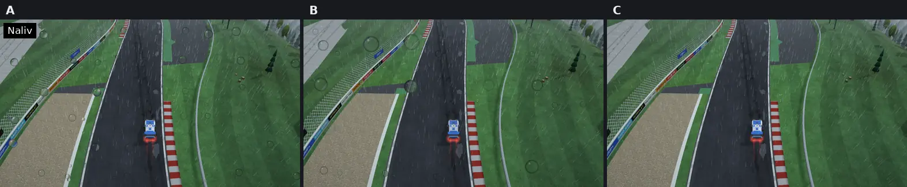
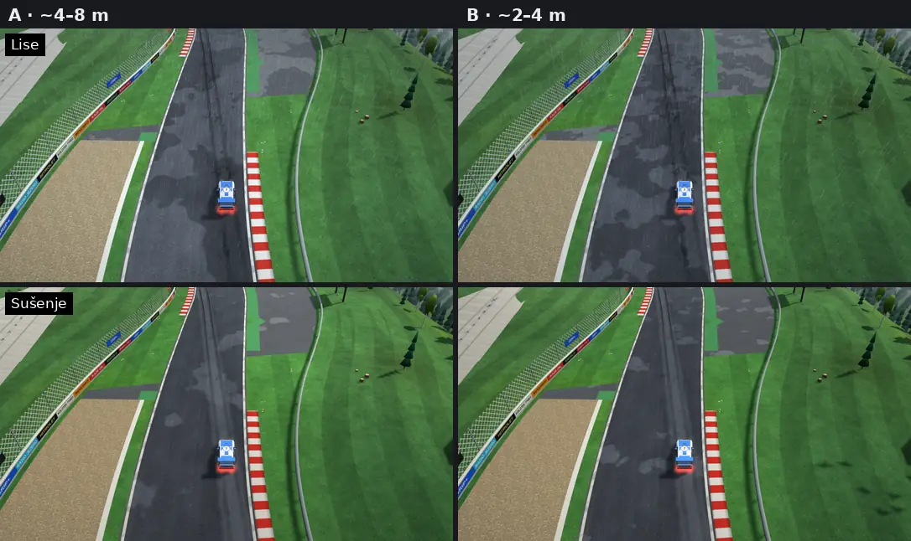

# Vreme med dirko: grafika (suho → ploha → suho)

Spa, Belgija, ~1100 m od štarta, kamera za avtom, kakovost Visoka. Stanja so nastavljena kot med plohami na dan s spremenljivim vremenom (`weather.test.mjs` preveri isto).

- **Suho**: enako kot prej.
- **Oblačno** (60–90 s pred plohe): sonce se skrije, svetloba je siva in mehka, sence šibke; prej je bil dan sončen do prve kaplje.
- **Lise** (prve kaplje, voda 15 %): cesta potemni v lisah; prej je bila po vsej širini enako mokra.
- **Naliv**: enako kot prej (brez kapljic na objektivu, izbira C).
- **Sušenje** (voda 20 %): cesta se suši v lisah, idealna linija prva; prej enakomerno.

Suha linija in luže sta na tak dan narejeni že ob štartu (skriti), zato igra ob prvih kapljah ne zastane. Novih klicev risanja ni.

**Odločitve uporabnika 23. 11. 2026**: kapljice **C** (brez), lise **B** (~2–4 m), ikona **B** (`docs/vreme-ikona`). Slike po izbiri: `docs/slike/vreme/`.

## 1. Kapljice na objektivu (naliv)

- **A** · zdaj v kodi: dve plasti, drobne in srednje; nad avtom in cesto tik pred njim jih je manj.
- **B** · manj, večje in bolj zamegljene, šibkejši odsev neba.
- **C** · brez kapljic (dež, pršec in mokra cesta ostanejo). **Izbrano 23. 11.**

Priporočilo je bilo A; uporabnik je izbral **C**.

## 2. Velikost lis (prve kaplje, sušenje)

- **A** · večje lise, ~4–8 m.
- **B** · drobnejše lise, ~2–4 m. **Izbrano 23. 11.** (zdaj v kodi: šum 0,25 m na teksel).
