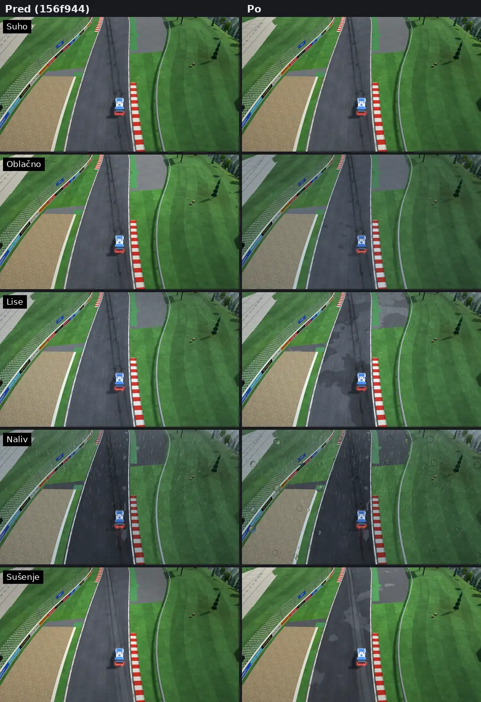

# Vreme med dirko: grafika (suho → ploha → suho)

Spa, Belgija, ~1100 m od štarta, kamera za avtom, kakovost Visoka. Stanja so nastavljena kot med plohami na dan s spremenljivim vremenom (`weather.test.mjs` preveri isto).

- **Suho**: enako kot prej.
- **Oblačno** (60–90 s pred plohe): sonce se skrije, svetloba je siva in mehka, sence šibke; prej je bil dan sončen do prve kaplje.
- **Lise** (prve kaplje, voda 15 %): cesta potemni v lisah; prej je bila po vsej širini enako mokra.
- **Naliv**: nove kapljice na objektivu (samo v najmočnejšem dežju in v pršcu avta tik pred nami); drugo enako.
- **Sušenje** (voda 20 %): cesta se suši v lisah, idealna linija prva; prej enakomerno.

Suha linija in luže sta na tak dan narejeni že ob štartu (skriti), zato igra ob prvih kapljah ne zastane. Novih klicev risanja ni: kapljice so v končnem prehodu slike (samo Visoka).

## 1. Kapljice na objektivu (naliv)

- **A** · zdaj v kodi: dve plasti, drobne in srednje; nad avtom in cesto tik pred njim jih je manj.
- **B** · manj, večje in bolj zamegljene, šibkejši odsev neba.
- **C** · brez kapljic (dež, pršec in mokra cesta ostanejo).

Priporočilo: **A**.

## 2. Velikost lis (prve kaplje, sušenje)

- **A** · zdaj v kodi: večje lise, ~4–8 m.
- **B** · drobnejše lise, ~2–4 m.

Priporočilo: **A**. Grafika gre na `main` šele, ko uporabnik reče »ok« (CLAUDE.md, Grafika in meni).
