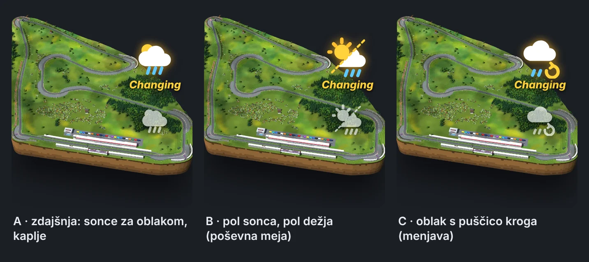

# Ikona »Changing« v stolpcu Weather (Vreme med dirko, korak 3)

Zgoraj izbrana (velika, v barvah, z imenom), spodaj neizbrana (siva), na sliki proge (Spielberg, Avstrija).

- **A** · zdajšnja v `js/menu.js` (`wxIcon('change')`): sonce za oblakom, kaplje. Blizu ikone Rain; razlika je samo sonce.
- **B** · pol sonca, pol dežja, poševna črtkana meja: najbolj se loči od Dry in Rain.
- **C** · oblak s puščico kroga: »menjava«; siva puščica je majhna.

Priporočilo: **B**. **Uporabnik je 23. 11. 2026 izbral B**; v `js/menu.js` (`wxIcon('change')`). Slika: `docs/slike/vreme/ikona-po.webp`.
